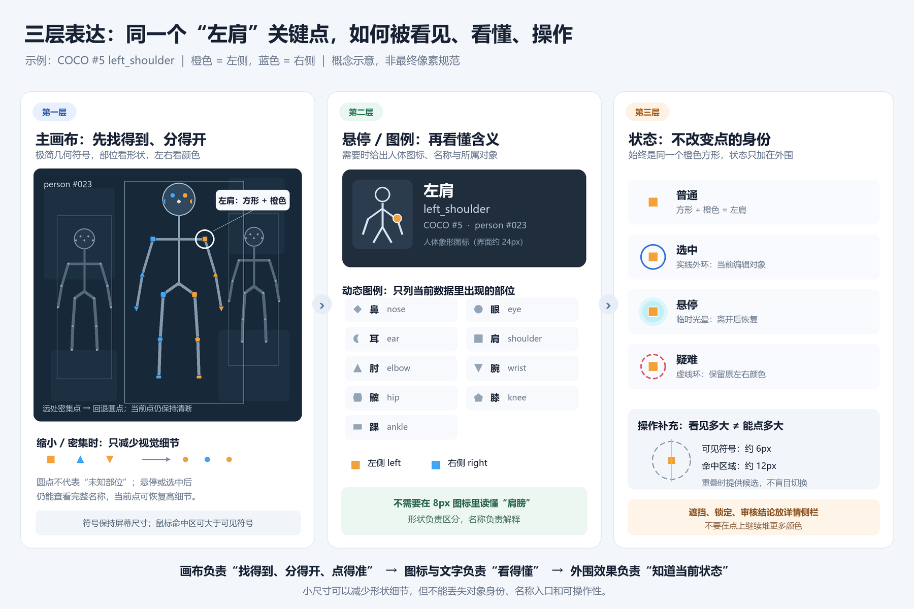

# CUSTOM-122：关键点三层表达与画布符号方案

- 状态：**方案，未实施**。已完成真实照片的静态对照评审，应用内渲染与交互待实现和验收。
- 功能分类：原功能修改的后续设计，服务于密集复核中的框与关键点观察。
- 创建日期、最后更新日期：2026-11-13（Asia/Shanghai）。
- 原始版本与基线提交：X-AnyLabeling 4.2.1；记录时 HEAD 为 `2b120beaf20968f2761022e53522c6080179e8f6`。
- 实现提交 / PR：无。
- 前置关系：承接 CUSTOM-121 的显示角色、点符号与编辑手柄分离设计；完整关键点审核仍另行规划。
- 工作区边界：方案、概念示意图、索引及操作记录。真实样本对照图随会话交付。

## 1. 问题与目标

### 1.1 问题

密集人体图片中，关键点同时面临四项任务：

1. 在原图和骨骼线上仍能看见点的位置；
2. 区分部位和左右，避免相邻点互相混淆；
3. 能准确悬停、选中并编辑目标点；
4. 能知道点的名称、所属人物和当前状态。

如果要求 COCO 17 个关键点都使用独立的人体器官图标，小尺寸下图标会失去内部细节，密集场景中还会增加遮挡。如果只使用无差别圆点，则位置虽然可见，部位身份和左右关系又难以辨认。

因此，本方案不追求“一个图标在所有尺寸和场景中承担全部信息”，而是把显示拆成三层：

> **主画布负责找得到、分得开、点得准；人体图标与文字负责看得懂；外围效果负责知道当前状态。**

### 1.2 目标

- 用少量几何符号降低学习成本和视觉噪声；
- 在需要时提供完整的中英文名称、人体象形图标和所属对象；
- 将部位身份、左右属性、交互状态和审核结论分开表达；
- 让小尺寸回退只减少视觉细节，不丢失名称入口和可操作性；
- 保持现有关键点数据、分组、保存和训练导出含义不变。

### 1.3 不在本项中

- 不实施完整关键点的类别、位置、归属、遮挡、缺点或姿态完整性审核；
- 不因点被显示、定位或编辑而写入“关键点已审核”结论；
- 不把 COCO 17 点写死为所有模型和数据集的唯一结构；
- 不在本方案中确定最终像素、颜色和图标资源的验收值；
- 不处理视频轨迹、点云或自动模型推理。

## 2. 三层表达总览

图中以同一个 COCO 左肩点为例：它在主画布中是橙色方形，在解释层显示“左肩 / left_shoulder / COCO #5”，在状态层始终保持橙色方形，只改变外围提示。

| 层级 | 出现位置 | 推荐形式 | 回答的问题 |
| --- | --- | --- | --- |
| 第一层：画布标记 | 主画布、人物局部观察、缩略观察 | 当前人物用部位符号及左右配色，其他可见人物默认用淡色小点 | 点在哪里，属于哪个部位和哪一侧 |
| 第二层：语义解释 | 图例、悬停提示、当前点详情、人物卡子项 | 按需显示部位名称、原始标签和组号，详情可配人体部位图标 | 确认点的部位、左右和所属人物 |
| 第三层：交互与状态 | 点符号外围及详情侧栏 | 选中用对比外环，悬停用轻量提示，疑难等状态在侧栏说明 | 当前操作的是哪个点 |

三层描述的是同一个点的三种信息。普通浏览时画布以点标记为主，解释和状态随当前交互出现。上图的四种状态用于说明概念，首版的组合规则见第 5 节。

## 3. 第一层：主画布几何符号

### 3.1 使用“基础部位 × 左右属性”，而不是 17 套无关图标

以 COCO 17 点为例，可归为九类基础形状：

| 基础部位 | 建议几何轮廓 | 左右组合 |
| --- | --- | --- |
| 鼻 | 菱形 | 独立点，无左右属性 |
| 眼 | 圆形 | 左眼、右眼 |
| 耳 | 半圆形 | 左耳、右耳 |
| 肩 | 方形 | 左肩、右肩 |
| 肘 | 上三角形 | 左肘、右肘 |
| 腕 | 下三角形 | 左腕、右腕 |
| 髋 | 六边形 | 左髋、右髋 |
| 膝 | 五边形 | 左膝、右膝 |
| 踝 | 横向圆角矩形 | 左踝、右踝 |

这样形成“1 个独立部位 + 8 组成对部位”，用户需要学习的是少量基础形状和一套左右规则，而不是 17 个互不相关的图案。

上述映射是人体预设的候选形状。标签映射由数据集或模型配置提供，例如 `right_elbow` 与 `r_elb` 可以指向同一部位。人脸、手部、动物及自定义关键点使用各自的映射。未识别标签使用通用点符号，并始终保留原始标签文本。

### 3.2 左右编码和照片对比度

- 按人物自身的左右取色，左侧橙色、右侧蓝色、中线用中性色。同一部位的左右共用轮廓。
- 主符号使用细的中性对比描边。首版按符号覆盖范围附近的底图亮度选色，深背景用浅边，浅背景用深边。采样面取当前实际显示的底图，包含亮度和对比度调整；选中色和描边都不改变左右颜色。底图或缩放改变时更新采样，悬停重绘复用已有结果。
- 图例显示形状及“人体左侧／人体右侧”。在灰度或色弱条件下，悬停、选中详情和人物卡仍明确显示侧别。实心／空心和方向缺口作为后续对照项，先验证它们在最小尺寸的照片上是否仍能读出。

### 3.3 使用离散细节档

首版以复核角色选择两档，缩放只改变点在画布上的投影位置与间距。

| 细节档 | 显示内容 | 使用场景 |
| --- | --- | --- |
| 部位符号 | 基础轮廓、左右颜色及对比描边 | 当前人物的有效可见点。当前点保持可辨认的部位符号 |
| 弱化小点 | 低遮挡的淡色圆点及必要的细描边 | 本批其他人物和背景人物的有效可见点，沿用 CUSTOM-121 的角色强度与隐藏结果 |

弱化点在悬停、选中详情和人物卡中仍可查询原始身份。悬停只临时解释。后续若需要在当前人物内部自动简化，按投影后的邻近点间距判断，升档和降档使用不同阈值，避免缩放时反复跳档。

### 3.4 明确“固定屏幕像素”的含义

点的中心由原图坐标投影到 QWidget 画布逻辑坐标。随后在同一逻辑坐标空间绘制符号、描边和外环，线宽及尺寸均以逻辑像素指定，由 Qt 映射到物理像素。符号路径以真实点坐标为锚，缩放、滚动和 DPR 变化均不改变标注坐标。缩略图按其目标显示尺寸单独绘制。

概念图的尺寸只说明交互意图。真实照片试画使用约 11 px 的部位符号和约 5 px 的背景点，均为输出图像像素。应用的逻辑像素尺寸、线宽和命中半径由实际画布验收确定。

## 4. 第二层：图例、悬停和当前点详情

### 4.1 悬停提示

画布默认收起关键点的常驻标签及引线。悬停一个点时，只显示该点的简短提示：

- 部位与侧别、原始标签及所属人物或 `group_id`，例如“右肘 / `r_elb` / 人体组 0”；
- 数据配置提供明确序号时可附带序号。人体部位图标和遮挡、锁定等信息优先放在当前点详情。

悬停只提供临时解释，不改变当前审核对象，也不绕过手动隐藏、类别过滤或分组过滤。离开后恢复原显示角色。

提示框限制在视口内并避开当前点和编辑手柄。选中点的名称可在固定详情区持续读取，画布只保留一个随指针变化的临时提示。

### 4.2 动态图例

图例只列当前数据中实际出现的部位，避免每次展示全部理论类型。每项同时包含几何符号、左右示例和中英文名称。未知或自定义标签进入“其他关键点”，不伪造人体部位图标。

### 4.3 当前点详情

当前点详情是完整、稳定的信息入口，适合显示悬停提示无法承载的内容：

- 点的稳定身份、原始标签和所属人物；
- 坐标、数据可见性、遮挡或困难属性；
- 当前编辑限制和关联对象；
- 当前版本是否支持该点的审核结论。

选中、浏览和编辑本身仍不等于审核通过。

## 5. 第三层：状态与操作

### 5.1 状态表达保持正交

| 信息 | 推荐表达 | 不应复用的通道 |
| --- | --- | --- |
| 部位身份 | 基础几何形状 | 不用审核状态改变形状含义 |
| 左右属性 | 橙/蓝及解释层的左右文字 | 不被选中色、异常色覆盖 |
| 当前选中 | 清晰实线外环 | 不改变点的原始部位颜色 |
| 临时悬停 | 名称提示，可配轻量光晕，离开恢复 | 不自动修改当前对象 |
| 疑难 | 首版在详情中说明，后续若在画布启用独立提示，虚线沿用 CUSTOM-121 的疑难含义 | 不与左右颜色混用 |
| 遮挡、锁定、审核结论 | 详情侧栏完整说明，画布只保留必要提示 | 不继续堆叠更多填充色 |

每个点至多使用一种外围效果。选中外环优先于同一点的悬停光晕。选中点最后绘制在其他关键点上方，当前编辑预览和手柄沿用 CUSTOM-121 的层级。疑难、遮挡和锁定等组合信息由侧栏说明。

### 5.2 可见符号、命中区域和编辑手柄分离

- 命中以正式点坐标为圆心，半径按画布逻辑像素独立设定，并覆盖可见符号本体。外围提示不扩大命中范围。专用关键点分支统一提供悬停、点击和拖动起始候选，避免继承通用点的 `epsilon × 3` 回退范围。
- 当前编辑对象的有效手柄和边优先。进入点候选后按投影中心到指针的距离排序，距离相近时用复核角色和稳定对象顺序打破平局。
- 近乎重合且无法明确选中时提供候选列表，显示部位、原始标签和所属人物。明确选择后才切换编辑目标。
- 拖动、绘制和几何预览期间锁定编辑目标，指针经过其他点时继续操作原对象。

完全隐藏的对象不参与画布命中；弱化但可见的对象可以参与。普通悬停和聚焦尊重显式隐藏及过滤，需要从侧栏观察被排除对象时使用 CUSTOM-121 的明确“临时显示”动作。

## 6. 一个完整示例：左肩

以 `left_shoulder` 为例，用户实际操作过程应当是：

1. 在主画布看到橙色方形，知道它属于肩部类别和左侧；
2. 点较小时，即使只能看出一个橙色标记，也不必从像素中读出“肩膀”；
3. 悬停后出现人体肩部图标、“左肩 / left_shoulder / COCO #5”和所属人物；
4. 明确选中后出现实线外环，橙色方形保持不变；
5. 如果该点同时属于疑难对象，画布保留选中外环，侧栏显示疑难原因；
6. 如果附近有点或手柄重叠，用户通过候选列表明确切换，拖动中不跳目标；
7. 用户只浏览或拖动该点时，系统不会因此写入“左肩已审核”。

## 7. 与现有设计的关系

- CUSTOM-121 已区分正式关键点标记与矩形编辑手柄，见 [技术设计](../../openspec/changes/redesign-dense-review-workspace/design.md) 和 [显示规格](../../openspec/changes/redesign-dense-review-workspace/specs/dense-review-display-policy/spec.md)。本方案补充点符号本身的身份、释义和状态分工。
- 当前人物、本批人物和其他人物仍由 CUSTOM-121 的显示角色决定。三层表达不另建一套可见性优先级。
- 人物框确认与关键点核验状态继续分列。点符号升级不改变 CUSTOM-121 的确认范围。
- CUSTOM-120 是显示档位的早期草案。CUSTOM-121 的有效显隐与命中规格是本方案的依赖。

## 8. 未来实施位置建议

下表只记录未来实施候选，不表示这些文件已经修改。

Canvas 从 CUSTOM-121 的有效可见性结果派生关键点样式，供点符号、外围效果、画布文字与引线、鼠标命中共用。先判断全局标注和原图对照，再处理隐藏、过滤与明确的临时显示，最后应用角色及交互状态。复核预设中，每个正式关键点只走一次专用绘制，旧标签路径对该点同样遵守有效可见性和文字策略。

| 位置 | 建议职责 | 迁移注意事项 |
| --- | --- | --- |
| 可选新增 `keypoint_glyph.py` | 标签到基础部位、左右属性、细节档的纯映射 | 配置驱动，未知标签回退，不依赖 Qt，便于单测 |
| `views/labeling/shape.py` | 保留普通画布的默认几何绘制 | 复核关键点符号由独立入口绘制，矩形和多边形控制点继续走 `draw_vertex()` |
| `views/labeling/widgets/canvas.py` | 统一使用有效可见性，组织关键点绘制、文字和命中 | 共享图像到画布的投影，验证 DPR、手柄优先级和拖动目标锁定 |
| `dense_review/workspace.py` 或独立详情控件 | 图例、悬停释义和当前点详情 | 不将浏览或选中写成审核结论 |
| 配置与翻译 | 可选显示偏好、中英文名称和图例文案 | 新配置进入 schema；资源变化后按规定重新生成 |
| 测试目录 | 纯映射、像素、DPR、命中、未知标签和交互回归 | 离屏像素测试之外仍需真实屏幕验收 |

建议先以 Dense Review 的可选显示预设接入，普通画布默认保持原行为。只有映射、绘制和命中回归通过后，才评估是否推广到其他关键点视图。

## 9. 兼容与数据影响

- 不修改 `shape.label`、点坐标、`group_id`、保存顺序或训练导出格式；
- 不新增审核命名空间，不改变既有复核进度和签名；
- 部位映射是视图层派生结果，原始标签始终保留；
- 显示档位、图例和悬停不进入撤销历史，几何编辑仍走现有撤销流程；
- 未知标签、缺失配置或无法绘制象形图标时，回退为通用点符号和原始文本，不隐藏正式对象；
- 所有绘制和命中仍在 GUI 主线程，图标缓存不得让旧图片结果覆盖新图片。

## 10. 验证

### 10.1 未来功能验证计划

| 维度 | 最低检查 |
| --- | --- |
| 映射 | COCO 17 点、无左右点、自定义标签、未知标签和大小写边界 |
| 可读性 | 在浅衣、深衣和纹理背景对照两档与描边，覆盖灰度、色弱模拟、不同 DPR 和实际窗口缩放。重点比较髋／膝、肩／踝和肘／腕轮廓 |
| 回退 | 圆点回退后名称仍可查询，当前点保留足够辨识度 |
| 状态 | 普通、选中、悬停、疑难及组合状态下保持部位颜色和轮廓，单点最多一个外围效果 |
| 命中 | 小点可点、重叠候选明确、手柄优先、拖动不跳目标 |
| 显示策略 | 手动隐藏、过滤、临时显示、原图对照和角色优先级不回归 |
| 数据 | 保存、撤销、改组、训练导出往返及旧文件读取不改变含义 |
| 性能 | 以 6 个矩形、92 个关键点及更密集样本测量绘制和悬停响应 |
| 人工验收 | 在同一真实样本和倍率下对照现有圆点与新预设，记录找点耗时、部位或左右辨认错误及首次点选命中率 |

### 10.2 静态试画与评审结果

- 示意图生成脚本的 5 项自动检查通过，覆盖 PNG 尺寸、非空内容、三层标题、左肩身份、四种状态和橙蓝颜色。
- 示意图已用本机图片查看器打开并通过 OCR 核对主要中英文内容；OCR 识别误差不等同于原图乱码。
- 使用 HK_2259 数据集的 `s1194.jpg` 及配套 `s1194.json` 静态绘制两组人体的 26 个真实关键点（组 0 为 14 个点，组 1 为 12 个点）。两侧全图与局部图分别保持相同的裁切和比例，只画关键点。左侧模拟按类别着色的圆点。右侧按部位画组 0，弱化组 1，局部图模拟右肘选中外环与名称、组号。
- 评审认为试画更清楚。全图的改善主要来自弱化另一组点。局部图中的肩方形和踝的扁长轮廓易分辨。组 0 的 `r_elb` 与 `r_hip` 仅相距 5 个原图像素，全图仍会重叠。局部选中提示只演示结果，候选切换须在应用中验证。
- 静态试画尚未测量点选命中率、阅读速度、不同 DPR 或重绘性能。应用、工具栏布局及点云测试均留待适用的实施验证。

## 11. 迁移与回退

未来实施时建议按以下最小批次推进：

1. 实现配置驱动的纯标签映射，覆盖 COCO 名称、样本中的 `r_elb` 等缩写及未知标签回退。
2. 在 Dense Review 可选预设中接入共享可见性、屏幕空间符号、独立命中和现有手柄优先级，验证隐藏同步及普通画布回归。
3. 接入单点解释、侧栏详情、选中外环和重叠候选，验证悬停、选择和拖动。
4. 用真实样本对照验收形状、描边、缩放与 DPR，再决定尺寸和后续密度切档。

若只需撤销本功能，应关闭新显示预设并移除对应映射、绘制和详情代码，恢复原默认绘制路径。不得通过恢复整个旧文件连带覆盖其他画布功能；现有标注和复核数据无需迁移或回退。

## 12. 后续修订

| 日期 | 原因 | 实际改动 / 提交 | 验证结果 |
| --- | --- | --- | --- |
| 2026-11-13 | 保存三层表达方案及左肩示例 | 新增方案文档、示意图和 CUSTOM-122 索引；未实施程序 | 示意图 5 项自动检查通过；9 个必需章节、54 个本地链接、行尾空白及图片一致性检查通过 |
| 2026-11-13 | 按真实样本评审修订三层方案 | 更新两档符号、照片对比描边、单点解释、外围状态及统一显隐和命中规则 | 复核 `s1194` 静态对照；应用验证待实施 |
