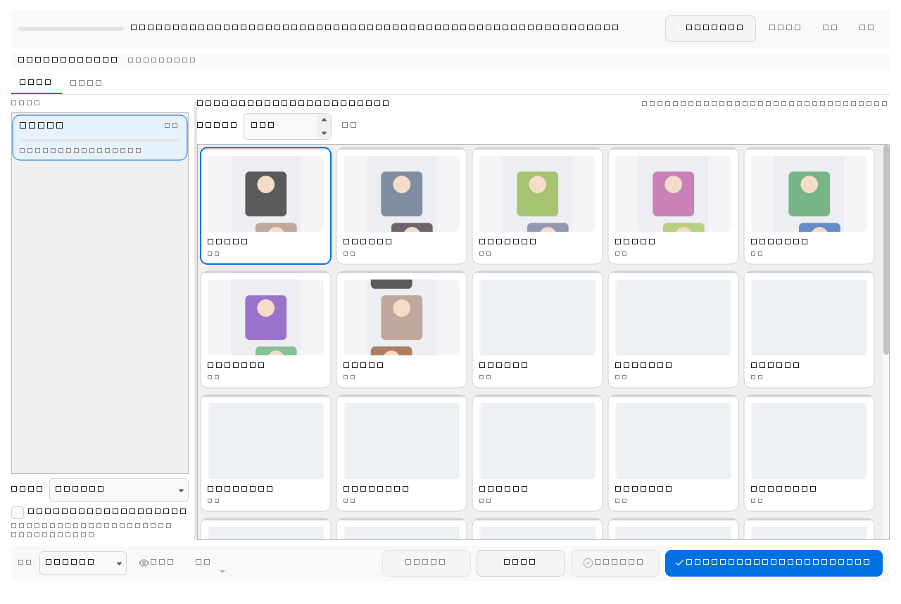
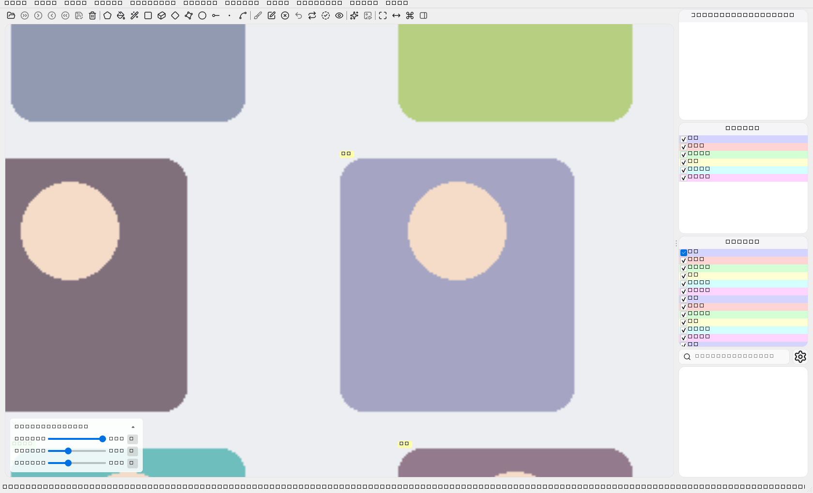
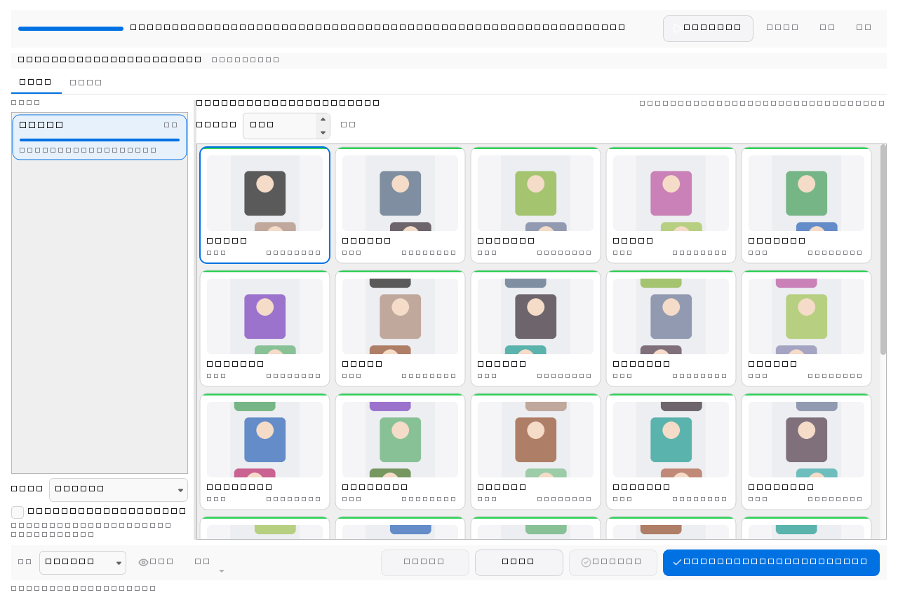
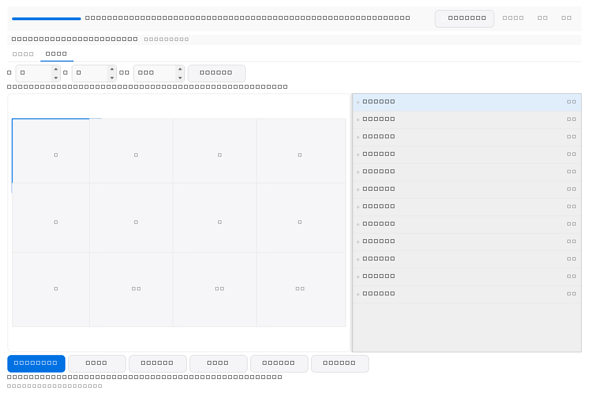
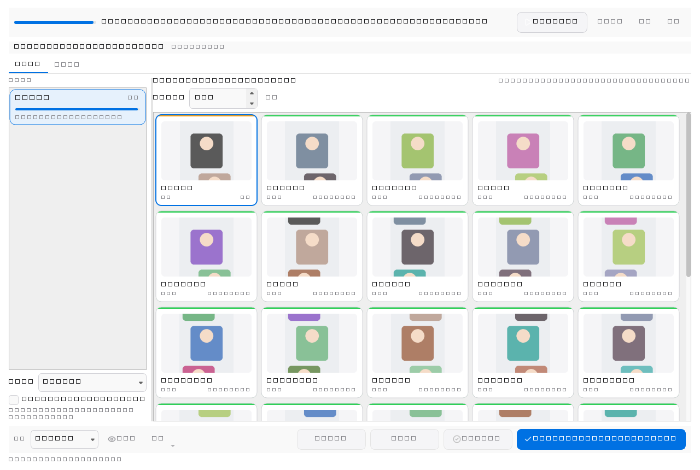
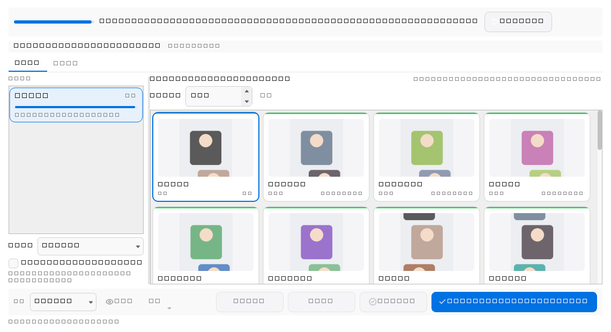

# 密集标注复核工作流（用户操作说明）

本文面向标注与复核人员，说明如何在密集人体/多目标场景中使用「密集复核工作区」。
该工作区默认关闭，关闭时不影响原有的画布、保存与撤销流程。

## 大白话：把一张图里的框分批过一遍

Inspector 帮你挑出规则命中的疑点；Dense Review（密集复核）把已有框做成小卡片、
分成一批一批，方便你自己看“类对不对、框合不合适”。目标很多时尤其有用。
它不会自动找出所有错误，也不会自动补框。

第一次可以这样试：

1. 打开一张已经画了矩形框的图片，从 **工作流 → 密集复核** 打开工作区。
2. 选一个类别批次，审核范围选“类别 + 框”。点卡片，画布就跟着选中对应框。
3. 不放心整批确认时，先勾“逐框模式”：看一个，错了就直接改；确认没问题再点“完成并下一个”。
4. 拿不准就“标记疑难”，暂时不想处理就“暂跳”。它们会留下待处理记录。
5. 这一批确实都看过了，再用“完成本批并进入下一批”。它会确认符合条件的整批对象，
   **包括尚未滚动看到的卡片**，所以不要只看第一屏就点整批完成。
6. 最后切到“空间查漏”：按区域看原图，有漏画的就补框，看完一块点“完成区域并下一区”。
7. 正常保存标注，框和复核进度一起保存。只关闭工作区不等于保存。

举个例子：一张教室图片有 80 个人框。你可以先按批次核对 80 个已有框，
再按区域看有没有第 81 个人漏画。前一步检查“已画的对不对”，后一步检查“该画的有没有漏”。
这两项都做完，才有条件显示全流程完成；正式的“已检查”标记仍要单独操作。

> 适用范围：普通矩形（rectangle）标注。多边形、旋转框、圆形等形状会显示为
> 「首版不支持」，只能做部分复核，不会被计为全流程完成。

## 1. 什么时候用它

- 一张图里有几十个同类目标，逐个点选、逐个确认很慢；
- 需要在不放大到每个框的情况下，快速判断「这一批类别对不对、框是否可用」；
- 需要区分「我确实看过并确认」与「系统只是把图显示出来了」。

它不会自动判断标注是否正确，也不会把「原样保留」当成质量通过。是否勾选
「已检查」（旧 `checked` 字段）仍是独立动作。

## 2. 打开与关闭

1. 打开一张图片及其标注；
2. 从工作流菜单进入「密集复核」工作区，或使用可配置快捷键 `Ctrl+Alt+R`；工作区默认不自动打开；
3. 首次进入会按当前类别规则生成批次；点「开始/重建本轮」可显式重建。

关闭工作区只会恢复原来的画布显示，不会修改标签内容，也不会写文件。
窄窗口下可分别隐藏类别批次栏和对象卡片栏；待处理数量、审核范围和批次动作
仍保留，类别栏隐藏后可使用紧凑批次选择框。布局切换不代表确认。
复核进度保存在标注 JSON 顶层的 `xanylabeling_dense_review` 命名空间里，
不写入任何 shape，因此不会成为训练标签。

## 3. 默认流程：一次确认整批

1. 在「类别批次」中选择当前批次；
2. 选择「审核范围」：类别 + 框、仅类别、仅框；
3. 观察对象卡片与画布，必要时直接改类、拖框、拖动；
4. 点「完成本批并进入下一批」。

逐框模式下，「完成并下一个」及「暂跳下一个」在本批没有可继续对象时会进入
下一待审批次。批次高亮、对象卡片和画布保持同一目标；暂跳仍保持未决。

一次点击即可确认整批中所有候选对象。以下对象不会随批次自动确认：

- 手动隐藏或当前筛选排除的对象；
- 已标记「疑难」或「暂跳」的对象；
- 新增待处理（复制/新建）但尚未确认的对象；
- 加载失败、无法呈现的对象；
- 非矩形等不支持形状。

按钮上会显示「确认 N 个并下批，M 个待处理」，N 只代表本次实际确认的数量。
屏外尚未生成卡片的对象**会随批次确认**，因为确认代表你主动声明了这一批，
而不是系统证明你逐张看过。需要逐张检查时使用逐框模式。

## 4. 逐框模式

勾选「逐框模式（完成并下一个 / 暂跳下一个）」后，可用：

- 「完成并下一个」：只确认当前对象，然后跳到下一个待处理对象；
- 「暂跳下一个」：把当前对象留到本批之后，不确认。

普通循环查看、鼠标点选、缩略图浏览都只是导航，不会产生确认。

## 5. 疑难与暂跳

- 「标记疑难」：记录该对象需要人工判断；可填写原因，也可用快捷键直接标记；
- 「解除疑难」：只解除标记，不会自动确认；
- 「暂跳」/「取消暂跳」：把对象推迟到本批之后处理。

只要仍有疑难、暂跳或新增待处理对象，本轮就不会显示全流程完成。

## 6. 撤销与重做

复核进度和画布编辑共用一条历史：

- `Ctrl+Z` 撤销，`Ctrl+Shift+Z` 重做（可在设置中改键）；
- 一次整批确认记为一条历史，撤销后对象、进度和批次游标一起回到确认前；
- 连续撤销会按实际操作顺序进行：先撤最新的画布编辑，再撤更早的审核确认；
- 撤销后再产生新的编辑或确认，会清空可重做的历史（与常见编辑器一致）；
- 历史只保留最近一段（默认 10 条画布快照、100 条审核事务），更早的不可撤销；
- 画面缩放、选中、隐藏、切换显示模式都不进入历史。

## 7. 空间查漏

「空间查漏」页把整张图切成带重叠的区域，用于检查「有没有漏标」：

1. 设置列数、行数、重叠比例，点「重建区域计划」（改变粒度会重置覆盖）；
2. 点「定位当前区域」把画布移到该区域；
3. 在区域内查看，补画漏掉的目标；
4. 点「完成区域并下一区」。

普通平移、缩放、浏览缩略图**不算**完成区域。新增、删除、移动框会按旧/新位置
让相关区域失效；影响范围无法确定时整图保守失效。空标注图片同样需要查漏。

## 8. 卡片、上下文与对比

- 卡片显示类名、短编号和复核状态，与列表、画布选中保持一致；
- 「卡片上下文」调整卡片裁剪的留白比例，便于判断手臂、遮挡等边界；
- 「看全图」临时查看整图，返回时恢复原目标、中心与倍率；
- 「并排比较」临时对照两个对象，不复制标注、不改变身份；
- 图块尚未就绪时会主动加载并更新比较窗口；失败可点「重试」，关闭窗口后旧结果不会写入新的比较视图；
- 「更多」菜单里有解除疑难、取消暂跳、加入当前批次、查看成员、重建剩余队列等。

## 9. 保存、冲突与恢复

- 复核进度随标注一起保存；状态栏会显示「复核进度待保存」；
- 自动保存失败时，内存中的进度保留，原文件仍有效；
- 磁盘上的标注文件被其他程序修改时，会提示选择「重载外部文件」或「保留本地并保存」；
- 进度版本未知或文件损坏时，不会静默覆盖：会保留原内容并要求显式重建；
- 图像内容变化、规则变更会导致相应确认失效，这是预期行为。

## 10. 完成状态与质量

- 全流程完成需要同时满足：所有对象两项确认、无疑难/暂跳/新增待处理、空间覆盖完成；
- 完成后再次编辑会撤回完成状态；
- 工作区显示的完成、旧 `checked`/复核标记、质量结论是三个独立概念，
  不会互相改写；本功能不提供自动质量分数或准确率。

## 11. 快捷键（默认值，可在设置中修改）

| 操作 | 默认快捷键 |
| --- | --- |
| 打开密集复核 | 见「设置 → 快捷键 → Dense Review」 |
| 完成本批 | 见「设置 → 快捷键 → Dense Review」 |
| 完成当前对象 | 见「设置 → 快捷键 → Dense Review」 |
| 暂跳 | 见「设置 → 快捷键 → Dense Review」 |
| 标记疑难 | 见「设置 → 快捷键 → Dense Review」 |
| 切换显示方式 | 见「设置 → 快捷键 → Dense Review」 |
| 撤销 / 重做 | `Ctrl+Z` / `Ctrl+Shift+Z` |

工作区快捷键只在工作区窗口内生效，不占用数字改类、`Shift` 单点拟合、
方向键、撤销和创建模式等原有按键。

## 12. 常见问题

**问：为什么确认后还有对象显示「待查」？**
答：它们可能被手动隐藏、筛选排除、标了疑难/暂跳，或属于新增待处理对象。

**问：为什么改完一个框，之前的确认消失了？**
答：真实几何变化会让类别与框两项确认同时失效；只改缩放、颜色或显示方式不会。

**问：关闭工作区后进度还在吗？**
答：在。进度保存在标注 JSON 的顶层命名空间里，关闭工作区不会清除，也不会写文件。

**问：支持非矩形吗？**
答：首版只保证普通矩形；混合图会明确显示「部分复核」，不会错误显示全流程完成。

**问：可以把它当成交付验收吗？**
答：不可以。它只记录你的复核动作，不替代正式质量验收。

## 13. 界面截图

以下截图由 `scripts/capture_dense_review_screenshots.py` 使用 Qt offscreen
平台渲染本版本真实控件生成，不是设计草图。重新生成：

```bash
QT_QPA_PLATFORM=offscreen python scripts/capture_dense_review_screenshots.py
```

工作区总览（批次面板 + 卡片 + 画布）：



主窗口中的工作区：



一次确认整批之后：



空间查漏：



疑难状态：



窄窗口 + 中文长类名：



仍需人工补充的截图：复核配置对话框、四种界面语言下的工作区各一张。
offscreen 截图不能替代真实屏幕上的字体度量、缩放和卡片观感检查，
这部分仍属于人工验收（任务 10.4）范围。
